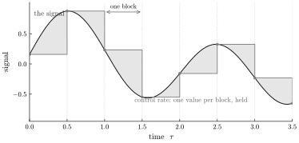
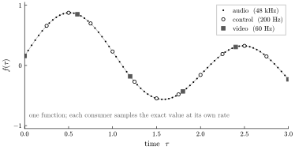

# There is no control rate

*Why the audio-rate / control-rate hierarchy is an artifact of buffers —
and what is left once you remove it: one closed-form signal, and consumers
that each sample it at whatever rate they need.*

In the streaming world you learn early that signals come in rates. There
is audio rate for the things you hear, and a coarser control rate for the
slow things — envelopes, LFOs, parameter sweeps. The distinction runs deep
enough that you write it into the type: a signal is `.ar` or `.kr`, and you
drop a converter wherever the two meet. It feels like a fact about signals.
It is not. The rate hierarchy is a fact about *buffers*, and when signals
stop being buffers it evaporates — leaving something simpler and slightly
disorienting: there is no control rate, because rate was never a property
of a signal, only of how fast you happened to read one.

## The hierarchy is a fact about buffers

Two pressures create the tiers. The first is efficiency: computing a
slowly-drifting envelope forty-eight thousand times a second is wasteful
when it barely moves between samples, so you compute it once per block and
hold it. The second is the block-processing architecture itself: audio is
pushed through in buffers of a few hundred samples, and the cheapest place
to update the slow signals is at block boundaries. Put those together and
the control tier is what you get — a signal known only at the seams between
blocks, held flat in between.

*Figure 1. A block engine refreshes a control-rate signal only at block
boundaries and holds it flat until the next one. The control tier is a
lossy, time-quantized, delayed approximation of the signal (shaded), and
the sub-block values it skips are simply gone — recovered, if at all, by
interpolation.*

Once that tier exists it hardens into a type. A signal is now audio-rate or
control-rate, and where one drives the other you need a converter —
upsample the control signal with interpolation to feed an audio input,
downsample an audio signal to read it as control. The rate is stamped onto
the signal, and every seam between rates is a small lossy negotiation.

And here is the tell that none of this was ever about the signals
themselves: a slow LFO and a fast oscillator are *the same kind of thing* —
a function of time. The architecture forces you to declare which tier each
one lives in, but nothing about the LFO makes it control-rate except your
decision to read it slowly. Hardware modular synthesis knew this and
refused the split: any signal patches into any input, and a cable does not
care whether what flows through it is "audio" or "control." The distinction
is a software convenience that calcified into a law.

## Remove the buffer and it has nothing to stand on

In Tropical there is no buffer to update at block boundaries. Every signal
is a closed-form function of the time coordinate,

$$ x \;=\; f(\tau, \text{params}), $$

and a *consumer* is anything that reads it: the audio device at 48 kHz, a
scope at its refresh rate, a control target at a couple hundred hertz, a
video frame at 60. Each one does the same thing — evaluate $f$ at the
coordinates it cares about. None of them is privileged, because the signal
does not know or care how fast it is about to be read. It is a function.
Rate is chosen entirely by the reader.

*Figure 2. One closed-form signal; three consumers sampling it at their own
rates. Every sample — dense audio, medium control, sparse video — lands on
the exact same curve. There is no held staircase, no rate conversion, and
no clock that the others are resampled from.*

Two things fall out, and they are the whole point:

- **Every consumer reads the true value.** A control target sampling at
  200 Hz evaluates $f$ at exactly those 200 instants and gets the real
  value at each — not a value held over from the last block, not an
  interpolated guess. The video frame at time $t_{\text{frame}}$ reads
  $f(t_{\text{frame}})$ exactly. There is nothing to convert, because
  nothing was ever quantized to a tier.
- **Consumers are automatically consistent.** They are all reading one
  function, so wherever two of their coordinates coincide they agree to the
  bit. The "control version" of a signal cannot drift from the "audio
  version," because there is no control version and no audio version —
  there is the signal, and there are readings of it.

## The efficiency, without the hierarchy

It is worth being honest about the pressure that created control rate,
because it was real: do not compute slow things at audio density. That
concern survives — but rate-agnostic consumers answer it correctly. A
consumer that needs a value 200 times a second evaluates the function 200
times a second, not 48,000. You get the efficiency by letting each *reader*
choose how densely to sample, not by stamping a rate onto the *signal*. The
optimization was right; encoding it in the signal's type was the mistake.
(That the whole patch fuses into one cheap per-sample kernel means even
reading everything at audio rate is usually fine — but the deeper point is
that you are never forced to.)

This is also why Tropical's internals are rate-neutral by hygiene rather
than by accident: a parameter is a `rate`, not a `sampleRate`; the things
that flow are `signals`, not `audio signals`. The roadmap's "control-rate
signals" are not a second type of signal — the phrase is shorthand for *a
signal read by a control-rate consumer*. Video synthesis, control output,
multiple backends running at independent rates: each is just another
consumer sampling the same kernel. Adding one costs no new resampling
machinery, because there is no clock to resample *from*.

## What this doesn't buy, and the one fact underneath

The honest boundary is Nyquist, and closed form does not repeal it. Each
sample a consumer takes is the exact value at that coordinate — but whether
its *sampling* captures the signal is still the consumer's problem. Read a
1 kHz signal at 60 Hz and it aliases, closed form or not; that is physics,
not architecture. What the closed form removes is the *resampling* error
stacked on top of it, and — because you hold the function, not a buffer of
it — it makes proper band-limited decimation available when a consumer
needs to sample below the signal's content: average $f$ over the frame in
closed form rather than point-sampling it. Exact at each coordinate is
guaranteed; adequate coverage is still the sampler's job.

And underneath, this is the same single fact the rest of this series keeps
finding. [The sawtooth](sawtooth-is-a-line.md) is a line read at whatever
coordinate you choose; [through-zero flanging](through-zero-flanging.md)
chose a shifted one, [reverse reverb](reverse-reverb.md) chose a forward
one, [the scope](phase-anchoring.md) chose a phase-aligned window — and a
consumer, here, chooses a *rate*, which is nothing but which coordinates and
how densely. There is no control rate for the same reason there is no
privileged reading: the signal is a function, and a rate is one of the many
ways to ask it questions. The hierarchy was scaffolding for a world made of
buffers. Take the buffers away and it falls down, and it turns out nothing
was resting on it.
