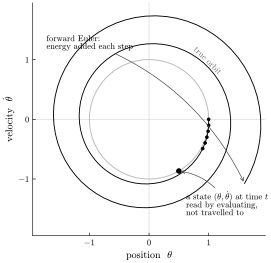
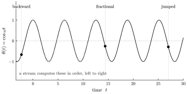
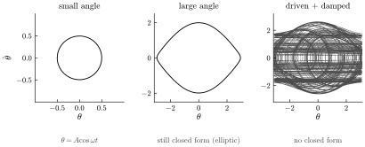

# Oscillation without accumulation

*A pendulum looks like an object with state — a position and a velocity,
stepped forward in time. It is really a function you evaluate at a
coordinate, and once you see that, jumping, reversing, and scrubbing stop
being features to build and start being arithmetic.*

A pendulum is the oldest clock and the first thing a physics class
simulates. A weight on a rod, pulled aside and let go, swings back and forth
— forever, in the idealization. Ask how to put one inside a program and the
answer arrives before the question finishes: it is *an object with state*.
It has a position, the angle $\theta$, and a velocity $\dot\theta$; to run
it you hold those two numbers and push them forward through time. That
instinct is so immediate it feels less like a choice than a description of
what a pendulum *is*. It is a choice. This chapter is about what the choice
costs, and about the whole world that opens the moment you drop it.

## The instinct: an object you step forward

For small swings the pendulum's law of motion is
$\theta'' = -\omega^2\theta$ — acceleration proportional to displacement,
always pulling back toward center. To simulate it you split that
second-order law into two first-order nudges and take small steps of size
$\mathrm{d}t$: from the state $(\theta, \dot\theta)$ at one instant, read the
acceleration $-\omega^2\theta$, nudge the velocity by it, nudge the position
by the velocity, and repeat.

$$ \theta \;\leftarrow\; \theta + \dot\theta\,\mathrm{d}t, \qquad \dot\theta \;\leftarrow\; \dot\theta - \omega^2\theta\,\mathrm{d}t. $$

This is (forward) Euler integration, and some version of it is how the great
majority of oscillating systems get computed. It works, and it hides three
costs — all three consequences of the same fact, that the value at any
instant is defined only in terms of the instant before it.

- **Sequential.** To know $\theta$ at some time $t$ you must have stepped
  through every instant between now and $t$. There is no asking for the
  state at $t = 10^6$ directly; you wind the accumulator a million times or
  you do not arrive.
- **Drift.** Each step approximates the smooth motion by a straight nudge,
  and the small errors do not cancel. For an oscillator, forward Euler
  systematically *adds energy*: the simulated pendulum swings a shade wider
  every cycle and, left running, spirals outward into a motion no real
  pendulum ever performed (Figure 1).
- **Reverse only by re-stepping.** You can run it backward by flipping the
  sign of $\mathrm{d}t$, but that is still stepping — sequential, and heir to
  the same drift. Reversal is a second traversal, not a free operation.

*Figure 1. The motion drawn in phase space — position $\theta$ against
velocity $\dot\theta$. The true motion is a closed orbit (gray): it returns
to where it began, forever. Forward Euler (black) injects a little energy
each step and spirals off that orbit, a pendulum that keeps climbing. And a
"state" is nothing but a single point on the true orbit — reachable by
evaluating the motion at $t$, without travelling the loop to get there.*

None of this is a bug in the arithmetic, and a cleverer integrator softens
the worst of it — a symplectic scheme keeps the energy from running away, so
the orbit stays closed on average. But no fixed-step method escapes the
first cost or the last: it is still sequential, still unable to land on a
distant instant without visiting the ones before it, and even the
energy-preserving schemes slip slowly in phase — the simulated pendulum
reaches the right place on the orbit at the wrong time. The trouble is not
Euler. The trouble is *stepping*, when there is something better to do.

## The pendulum is a cosine

Now drop the stepping. The small-swing law $\theta'' = -\omega^2\theta$ has
an exact solution, and it is the most familiar function in the subject:

$$ \theta(t) \;=\; A\cos(\omega t + \varphi). $$

This is not an approximation to the motion; it *is* the motion. $A$ and
$\varphi$ are fixed by where the pendulum started, and after that $\theta(t)$
is a plain function of $t$ — hand it a time, get an angle, with nothing held
between calls.

Here is the reframing the whole book turns on, shown on the oldest
oscillator there is. Where did the state go — the $(\theta, \dot\theta)$ that
felt so fundamental? It is still here, and it was never fundamental. The
position at time $t$ is $\theta(t) = A\cos(\omega t + \varphi)$; the velocity
is its derivative, $\dot\theta(t) = -A\omega\sin(\omega t + \varphi)$. The
state is *the function and its derivative, sampled at an instant.* It was a
**reading** of the motion, not the motion — a snapshot you may take at any
$t$ you like, directly, because the function is defined at every $t$ at once
rather than assembled one $t$ after another.

Once the state is a reading rather than a thing to carry, the three costs
are simply gone.

- **Jump.** $\theta(10^6)$ is one cosine, evaluated in a single step.
  Distance in time costs nothing; there is no accumulator to wind.
- **Reverse.** $\theta(-t)$ is as ordinary an argument as $\theta(t)$. The
  motion runs backward by reading it at decreasing $t$, with no history to
  unwind.
- **No drift.** There is no running sum to accumulate error; each
  $\theta(t)$ is computed from $t$ alone, exact and independent of every
  other, however long the instrument has played.

Put those together and the operation a stream cannot do at all falls out for
nothing — **scrubbing.** Drag the time coordinate by hand, forward or
backward, fast or slow or jumping, and the pendulum follows the gesture
exactly, because there is no latched state that could fall out of step with
your hand (Figure 2). A streaming simulation can be scrubbed only by
re-running it from a stored checkpoint; the closed form is scrubbed by
evaluating it where you point.

*Figure 2. $\theta(t) = \cos\omega t$ as a function of the time coordinate. A
streaming simulation produces the light points in order, one after the next,
and has reached only as far as "now." The closed form is under no such rule:
it is read at any coordinate in a single step — backward, before the run
began; between the samples; or jumped far past where a stream has computed —
because the value at $t$ depends on $t$ and nothing else.*

## The boundary

Everything above rests on one word: the pendulum *has* a closed form. That
is a real condition, and a chapter that showed only the happy case would be
selling past it. So follow the pendulum out to its edge — it is the rare
object that shows the whole boundary in a single breath.

Push the swing wider and the small-angle law stops being true. The honest
pendulum is $\theta'' = -\omega^2\sin\theta$, and $\sin\theta$ is not
$\theta$ once the angle is large; the cosine was an approximation after all.
Does the closed form survive the nonlinearity?

It does — and this is the reassuring surprise, worth meeting early. The
exact large-swing pendulum still solves in closed form; only the function is
a less familiar one, a Jacobi elliptic function $\mathrm{sn}$, the sine of a
clock that runs slower as the swing grows. Its period lengthens with
amplitude — a wide swing genuinely takes longer — and it is still evaluable
at any $t$, to any precision, without stepping. Random access, reversal, and
no-drift survive intact. "Closed form" was never a synonym for "sine and
cosine." It means a function you evaluate at a coordinate with bounded work,
and that tent is far larger than the linear case living inside it (Figure 3,
left and center).

Now drive the pendulum and damp it — push it with a periodic force, let
friction bleed energy away. For the right strengths this is one of the
textbook roads into chaos: the motion turns exquisitely sensitive to where
it began, two neighboring starts diverging without bound. Here the closed
form genuinely ends. There is no $f(t)$ to evaluate; the only way to know
where the pendulum is at time $t$ is to integrate, step by step — exactly
the marching this chapter set out to escape (Figure 3, right).

*Figure 3. The boundary in three phase portraits. Small swings trace a clean
closed orbit, $\theta = A\cos\omega t$. Large swings distort the orbit but
keep it closed — still a closed form, now an elliptic one, slower at the
extremes. Drive and damp the pendulum and the orbit dissolves into a chaotic
tangle: no closed form, only integration. The glasses survive nonlinearity;
they do not survive chaos, and they are not asked to.*

That last regime is not a failure of the method; it is its honest edge, and
it has a precise counterpart in signal terms. A closed form needs the whole
trajectory to be fixed in advance by the formula. Chaos denies that — and so
does the other case where no formula can exist: **recursive feedback on live
input**, where the value now depends on an input not yet received. There the
future you would need to evaluate is genuinely unavailable, and no $f(\tau)$
can stand in for it. That is the *ceded island*, set aside on purpose for a
different, stateful runtime. This book lives on the other side of the line,
where a closed form exists — which, as the pendulum has just shown, is a
much wider country than the word "linear" suggests.

## The change of view

One object, and the whole thesis is visible in it. A pendulum presents
itself as a thing with state, stepped through time; for as long as you
compute it that way you inherit the sequentiality, the drift, and the labor
of running it in reverse. Change the view — read the same motion as a
function you evaluate at a coordinate — and the state reveals itself as a
reading you can take anywhere, the drift has nothing left to accumulate in,
and jumping, reversing, and scrubbing turn from features to build into
positions to evaluate at. The rest of this book is that one change of view,
carried to signals with a longer reach than a pendulum's; but the move never
gets any deeper than it was here. The simplest of those signals is a
straight line, read modulo one — and it is [the next
chapter](sawtooth-is-a-line.md).
