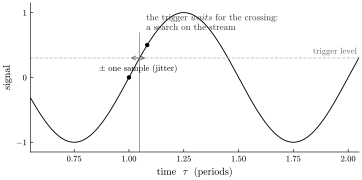
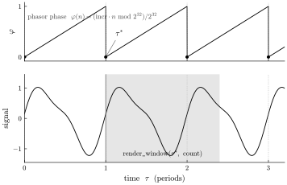
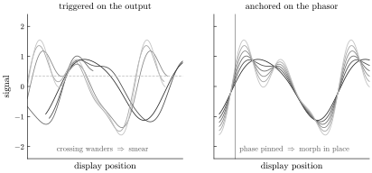

# Phase alignment by anchoring

*How an oscilloscope makes a waveform stand still — and why, once every
signal is a closed-form function of time, the century-old trigger dissolves
into a single exact subtraction.*

Point an oscilloscope at a periodic signal and, untreated, the waveform
races across the screen: each horizontal sweep starts at a slightly
different phase, so the trace slides and smears. To read it you must make
it stand still — every sweep has to begin at the *same* phase of the wave.
For a hundred years the answer has been the **trigger**: watch the signal,
and start the sweep the instant it crosses a chosen level on a chosen
slope. The trigger is a small marvel, and it is a permanent tax. It is
also, like the [flanger's delay](through-zero-flanging.md) and the
[reverb's tail](reverse-reverb.md), a stream-era artifact — a search
through the arriving signal for an event. When the signal is instead a
closed-form function of time, you do not search for the phase. You solve
for it.

## The trigger is a search on the stream

A trigger has only the stream. It cannot ask the signal where its next
cycle begins; it can only wait and watch the samples go by, and fire when
one of them crosses the level going the right way.

*Figure 1. The classic trigger. The sweep starts when the sampled signal
crosses the trigger level on a rising slope. The true crossing falls
between two samples, so the sweep start — and with it the whole trace — is
uncertain by up to one sample.*

That "wait and watch" is the root of every one of the trigger's
limitations:

- **It can fail to fire.** The level must actually be crossed. A signal
  that never reaches it draws nothing; a complex or noisy waveform crosses
  the level many times per cycle and fires on the wrong one. Real scopes
  pile on holdoff, hysteresis, auto/normal modes, and slope logic to tame
  this — all of it machinery for *choosing which crossing to trust*.
- **It jitters.** The crossing is an event in a sampled stream, resolved
  to the sample grid; sub-sample interpolation helps but the timebase is
  still recovered from the data, not known.
- **It guesses the frequency.** To set the horizontal scale, an auto-mode
  scope estimates the period from the signal — the same fragile
  period-finding a tuner does.
- **It locks to the shape, not the clock.** The crossing is a feature of
  the *output waveform*. Anything that moves that feature moves the trace.

Every one of these is downstream of the same fact: the trigger is
observing a signal it does not otherwise know.

## Anchoring: solve for the phase

In Tropical the scope knows the signal completely, because the signal *is*
a closed-form function of the time coordinate,

$$ x \;=\; f(\tau, \text{params}). $$

An oscillator is driven by a **phasor**, and the phasor's phase is not
something to be recovered from the output — it is a known function of the
sample index. In the engine it is literally an exact integer on the circle
$\mathbb{Z}/2^{32}$ (one turn $= 2^{32}$), advanced by a fixed increment
$\mathrm{incr} = \lfloor (f/\mathrm{SR})\cdot 2^{32} \rfloor$ set once by
the frequency — which is a parameter, so it is *given*, never estimated.
The phase is reduced back onto the circle every step, so its precision does
not decay however long the instrument has been running.

The **anchor** is simply the sample index where that phase is zero — the
cycle boundary. Because the phase is a known function of the index, the
anchor is *computed*, not found: no level, no slope, no holdoff, no scan.

*Figure 2. Top: the phasor's phase is a known ramp; its zero crossings are
the anchors $\tau^{*}$, available in closed form. Bottom: the scope fills
its display by evaluating the kernel over a window pinned to the anchor —
`render_window(τ*, count)` — a random-access read of the closed-form
signal, at the scope's own rate.*

Two consequences fall straight out of the arithmetic:

- **Zero jitter, exactly.** The anchor is applied as an *integer* subtract
  in the clock domain — the relative clock is `clk − anchor·2³²`, computed
  before anything touches a float. (This is the one place unbounded
  floating-point time would otherwise starve the mantissa; anchoring on the
  integer clock is precisely what keeps time-translation exact at any
  $\tau$.) The window's left edge lands on the phase you asked for to the
  bit, and it stays there an hour into playback.
- **No period-finding.** You already have the frequency. The timebase is
  set, not guessed.

The scope is not watching a stream stream past. It is evaluating a function
at the coordinates it chooses.

## Lock the timebase, not the output

Here is the move that matters most, and it is a choice, not a free lunch:
anchor to the *phasor's phase*, not to a feature of the *output waveform*.
A threshold crossing is a property of the shape. The phase is a property of
the clock. They agree for a plain sine and diverge the instant the timbre
moves.

*Figure 3. Six successive frames of a morphing timbre, overlaid. Left:
aligned by a threshold crossing of the output — as the shape morphs the
crossing wanders, so the frames smear and the trace walks. Right: aligned
by the phasor's phase — every frame is pinned at the cycle start, so the
timbre morphs* in place *and the display stays still.*

This is the qualitative upgrade. Sweep a wavetable, boil an FM patch's
sidebands, open a filter — the output's crossings lurch around, and a
trigger chases them across the screen. The phasor's phase does none of
that. Anchor to it and the sound is held perfectly still while its shape
changes; the scope shows the timbre *evolving* rather than *sliding*. You
are watching the sound, not fighting to pin it down.

## The window reaches both ways

Because the scope draws by *evaluating the kernel*, the display window can
begin *before* the anchor as easily as after. A digital scope shows
pre-trigger — signal from before the trigger event — only by continuously
recording into a circular buffer so it has the past on hand when the edge
fires. Anchoring needs no such buffer: the samples before the anchor are
the same closed-form function evaluated at smaller arguments, exactly as
cheap as the samples after it. Past and future of the anchor are
symmetric — the same fact that lets [through-zero
flanging](through-zero-flanging.md) read a negative delay and [reverse
reverb](reverse-reverb.md) reach a forward tap.

And you can move freely in that coordinate: freeze $\tau$ and slide the
anchor, zoom the timebase, scrub the whole patch backward. None of these is
a re-trigger, because there was never a trigger — only a function and the
coordinates you hand it.

## The scope is the moat, made visible

Every property the scope exploits is one property, read several ways:
*every signal is a closed-form function of the time coordinate, so time is
random-access.* The oscilloscope is the first and most literal consumer of
that guarantee — a consumer running at its own refresh rate, reading the
signal at whatever coordinates it likes. And because the guarantee is
unconditional, the anchor path has no fallback limb: the scope never has to
ask "is this signal closed-form?" before deciding whether it can be pinned.

The honest boundary is the same as the rest of the series. This is the
scope's behavior for signals it can evaluate as $f(\tau)$ — the instrument's
own synthesized signals. A live external input has no phasor and no
formula; there the scope is back to watching a stream, and the trigger,
with all its machinery, returns. That case is the ceded island, deferred to
a future stateful sister runtime. But for the signals the language is made
of, phase alignment is not a trigger tuned well. It is a subtraction done
exactly.

The flanger reaches microseconds ahead, the reverb reaches seconds ahead,
and the scope reaches wherever you point it — three faces of the same fact.
The oscilloscope is where you *see* it: a morphing sound held perfectly
still, not by chasing its shape, but by locking to its clock.
