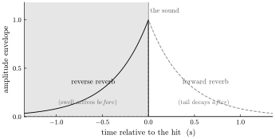
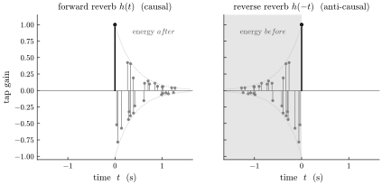
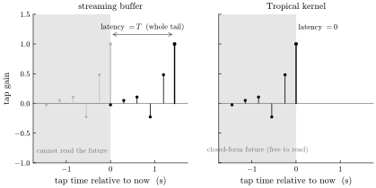

# Reverse reverb

*Why the reverberant swell that arrives* before *a sound has always been an
offline studio trick, and how a closed-form kernel plays it live at zero
latency.*

Ordinary reverb is an echo of the past: you strike a note and the room
answers *after*, a wash of reflections decaying into silence. Reverse
reverb is the uncanny inverse — the room answers *before*. A swell rises
out of nothing, grows, and resolves onto the note at the moment it lands;
the reverberation precedes its own cause. It is one of the most
recognizable gestures in recorded music, and it has always been made the
same way: reverse the recording, reverb it, reverse the result. That
recipe is an admission of defeat. It is offline by construction — you
cannot reverse a signal you have not finished recording — and it is the
reason reverse reverb lives in the studio and not on the pedalboard. This
document is about why that wall is made of the same brick as the
[through-zero flanging](through-zero-flanging.md) wall, and why a
closed-form kernel walks straight through it.

## The phenomenon: energy before the sound

Put a single percussive hit through a normal reverb and its amplitude
envelope is a sharp onset followed by a decaying tail. Put it through a
reverse reverb and the envelope is the mirror image: a swell that grows
*into* the hit and is gone by the time the hit arrives.

*Figure 1. Amplitude envelope of one hit. Forward reverb pours energy out
after the sound; reverse reverb pours it in before. Everything to the left
of the hit is the tell — reverberant energy that arrives ahead of its
source.*

That shaded region to the left of the hit is the whole problem. To
produce output *now* that anticipates a sound that has not happened yet,
you must already know the sound. On a recording you do; live, you do not.

## A reverb is a sum of shifted copies

Strip a reverb to its mechanism and it is a convolution — the input summed
against a set of delayed, decaying copies of itself:

$$ y(\tau) \;=\; \int h(s)\,x(\tau - s)\,\mathrm{d}s \;\approx\; \sum_k g_k\, x(\tau - s_k). $$

Each term $g_k\,x(\tau - s_k)$ is one reflection: a copy of the signal,
scaled by $g_k$ and shifted by $s_k$. The impulse response $h$ is the
whole family of reflections — where they land in time and how loud they
are.

A physical room is *causal*: every reflection arrives after the direct
sound, so $h(s) = 0$ for $s < 0$ and every tap has $s_k \ge 0$. Reverse
reverb is precisely the time-reversal of that impulse response,
$h_{\text{rev}}(s) = h(-s)$, which is nonzero for $s < 0$. Its taps sit
at $s_k \le 0$:

$$ y(\tau) \;=\; \sum_k g_k\, x\bigl(\tau - s_k\bigr) \;=\; \sum_k g_k\, x\bigl(\tau + |s_k|\bigr). $$

Every reflection now reads $x$ at a time *later* than $\tau$ — ahead of
now. The reverb has become **anti-causal**.

*Figure 2. A reverb impulse response as a stem of taps around the direct
sound (the tall stem at $t=0$), under an exponential decay envelope. Left:
a real room, all energy after. Right: the time-reversed impulse response,
all energy before — the reflections build up toward the sound instead of
falling away from it.*

## The wall

An anti-causal filter needs the future, and a real-time stream does not
have one. At sample $n$ the buffer holds the present and the past; it has
never held $x[n+1]$. A tap at $s_k < 0$ asks for exactly that. So the only
way to realize reverse reverb on a stream is the offline trick's real-time
cousin: **delay everything.** Bias the whole impulse response forward by
the tail length $T = \max_k |s_k|$ until the last anti-causal tap lands at
$s = 0$, and the direct sound — which the listener thinks of as "now" —
comes out $T$ seconds late.

*Figure 3. Left: reverse reverb wants its taps in the future (gray, in the
forbidden region). A causal buffer can only realize them by shoving the
entire impulse response into the past (black) — the direct sound slides
from now to $T$ ago, and $T$ is the added latency. Right: with no wall, the
taps stay where they belong and the latency is zero.*

This is the same causality wall as through-zero flanging, but the price is
now as large as the effect itself. A flanger reaches a fraction of a
millisecond into the future; you can bias that away and barely notice. A
reverb reaches its entire tail — hundreds of milliseconds, often seconds —
and the required latency is that whole tail. The gap between what a stream
can do and what the effect demands is not a detail here; it is maximal.
That is why reverse reverb never became a live, zero-latency effect —
distinct from a reverse *delay*, which plays a chunk of the *past*
backward and is perfectly causal. Anticipatory reverberation wants the
future, and you cannot read a sample that has not arrived — this effect
wants to read *all* of them.

## Tropical: the taps are arguments, not reads

Tropical has no stream to delay. Every signal in a patch is a closed-form
kernel — a pure function of a time coordinate,

$$ x \;=\; f(\tau, \text{params}), $$

with no buffer of past samples. A reflection is not a read from a delay
line; it is the same function evaluated at a shifted argument,
$x(\tau - s_k)$, and a function does not care about the sign of its
argument. Reading $x(\tau + |s_k|)$ — a reflection from the future —
is arithmetically identical to, and exactly as cheap as, a reflection from
the past. Put the anti-causal taps where they belong, at $s_k < 0$, and
the reverberant swell arrives before the sound with **no bias and no
latency** (Figure 3, right).

And the whole reverb collapses back into a single closed-form kernel. A
sum of scaled, shifted copies of $f(\tau, \text{params})$ is just another
function of $\tau$ — each tap is an affine warp of the time coordinate, and
a sum of affine warps is closed-form. There is no delay line, no ring
buffer, no state carried from one sample to the next.

This is the point worth slowing down on, because it sounds impossible.
*Doesn't a reverb inherently remember the past — isn't that what a tail
is?* A streaming reverb does: it must store a buffer of past input, which
is precisely why it can store the past and not the future. A closed-form
reverb remembers nothing. At each output sample it **re-derives** the
relevant slice of $x$ — past and future alike — by evaluating the formula
at the shifted arguments it needs, sums them, and keeps nothing. The
workspace it uses to add up the taps is rebuilt every sample and thrown
away; it is not state. The reverb "remembers" by recomputation, not by
storage, and recomputation is symmetric in time. That symmetry is the
whole trick: the past has no privileged status because nothing is being
retained, so the future is no harder to reach than the past.

A note on realization, to keep the claim honest. Written as a literal sum
of taps, the cost is compute — one evaluation of $x$ per reflection, per
output sample — and a dense sampled impulse response is a lot of taps.
That is the *exact* realization. A structured reverb — a modal decay, a
sum of exponentially-ringing modes — convolves against a closed-form
source into a *compact* closed form instead, trading tap-count for a
handful of coefficients. These are two realizations of the same reverb,
chosen by the fidelity you need against the cycles you have. What they
share is the part that matters here: both are stateless, and both reach
forward in time for free.

## Scope, and the moat it belongs to

The honest boundary is the same one as before. This holds when $x$ is
closed form — when the reverberated signal is *synthesized inside the
patch*. A live or external input has no formula to evaluate ahead of the
present, so the wall stands again and reverse reverb costs the full tail
in latency. That case is the ceded island — recursive processing of
live/external input, deferred to a future stateful sister runtime — and it
is ceded deliberately. Within the language's actual domain, patch
synthesis, reverse reverb is a first-class, zero-latency, real-time effect.

Reverse reverb is not a special capability bolted on. It is the single
property the whole instrument stands on, shown at its most dramatic:
**every signal is a closed-form function of the time coordinate, so time is
random-access.** Through-zero flanging reaches microseconds into the
future and it is free; reverse reverb reaches seconds into the future and
it is equally free, because "how far ahead" is just the size of an argument
and a formula has no horizon. A sample stream forbids reading the future;
a closed-form kernel has no future to forbid. Reverse reverb is where that
difference stops being a technicality and becomes a sound you have never
heard a live instrument make.
