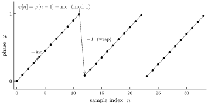
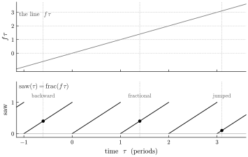
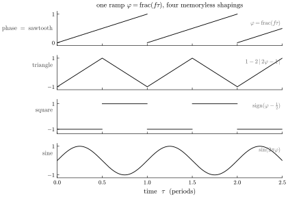

# The sawtooth is a line

*The simplest closed-form signal — a linear function of time, read modulo
one — and why "generating" it with an accumulator is exactly the state the
rest of this series does without.*

The three effects in this series so far — [through-zero
flanging](through-zero-flanging.md), [reverse
reverb](reverse-reverb.md), [phase alignment by
anchoring](phase-anchoring.md) — all lean on one move: a signal is a
function of the time coordinate, so you may read it at any coordinate you
like, including ones a real-time stream can't reach. That move is easiest
to doubt at the very bottom, on the humblest signal in synthesis: the
sawtooth. So this is the foundational note. The sawtooth looks like
something an oscillator *does*, step by step. It is really something far
simpler — a line — and seeing that is seeing the whole language in
miniature.

## The accumulator, and the state it carries

Open any DSP textbook and the sawtooth oscillator is three lines: keep a
running phase, add a small increment each sample, wrap when it passes one.

$$ \varphi[n] = \varphi[n-1] + \mathrm{inc} \pmod 1, \qquad \mathrm{inc} = f/\mathrm{SR}. $$

It works, and it hides a decision. The phase is *state* — a value latched
in a register and carried from each sample to the next. The output at
sample $n$ is not a function of $n$; it is a function of the entire history
that led there.

*Figure 1. The canonical sawtooth: a phase accumulated one increment at a
time, wrapped at one. The value at any sample is defined only in terms of
the sample before it — to know it, you must have taken every step up to it.*

Everything awkward about a classic oscillator follows from that latched
register. You cannot ask it for its value at some far-off time without
first winding it there. Running it backward means un-adding and un-wrapping,
bookkeeping in reverse. Its floating-point phase drifts as the increments
accumulate, so a long-running oscillator slowly loses precision. And a
change of frequency is a discontinuity in the recurrence that has to be
smoothed by hand. None of these are bugs in the three lines. They are the
price of keeping state.

## The sawtooth is a line

Now look at the same waveform without the accumulator. Strip the wrapping
away for a moment and what climbs is a straight line: $f\tau$, the phase
turning over at a constant rate. That line is *the* linear function of
time. The sawtooth is nothing but that line read modulo one —

$$ \mathrm{saw}(\tau) = \mathrm{frac}(f\tau). $$

There is no register and no recurrence. The value at $\tau$ is a function
of $\tau$ alone: multiply by the frequency, take the fractional part, done.

*Figure 2. The line $f\tau$ (top), crossing the integers, is read modulo
one to give the sawtooth (bottom). Because the value depends on $\tau$ and
nothing else, it can be read at any coordinate — a time in the past, a
fractional time, a time jumped to directly — with no steps in between.*

This is the same reframing the whole series turns on, shown on the smallest
possible example. The accumulator answers "what is the phase now?" by
having marched there. The line answers it by evaluating a formula. In
Tropical the phase is literally computed from the clock each sample rather
than latched — and it is computed in *exact integers*: the phase lives on
the circle $\mathbb{Z}/2^{32}$, advanced by a fixed increment and reduced
back onto the circle, so its precision does not decay however long the
instrument has run. The line never drifts, because there is no running sum
to drift.

## One line, four waveforms

The sawtooth turns out to be more than one waveform among many — it is the
*substrate* the others are built from. Once you have the phase $\varphi =
\mathrm{frac}(f\tau)$, the classic waveforms are memoryless shapings of that
one ramp:

*Figure 3. The phase is the sawtooth. Fold it and you have a triangle;
threshold it and you have a square; run it through $\sin$ and you have a
sine. Four waveforms, one line — the phase is the line, and the waveform is
a memoryless map of the phase.*

The triangle is the ramp folded, $1 - 2\,|2\varphi - 1|$; the square is the
ramp thresholded, $\mathrm{sign}(\varphi - \tfrac12)$; the sine is the ramp
through a sinusoid, $\sin(2\pi\varphi)$. Not one of these shapings carries
state — each is a plain function of the current phase. So the entire family
inherits the line's one virtue: read the phase at any coordinate and every
waveform reads correctly there, because every waveform is just a lens on the
same line. The oscilloscope's phasor from the [previous
note](phase-anchoring.md) was this exact ramp; the sine it displayed was
this ramp through $\sin$. The sawtooth is where every oscillator begins.

## Scrubbing: read the line anywhere

Because the waveform is $\mathrm{shape}(\mathrm{frac}(f\tau))$ and $\tau$ is
a free coordinate, the operations a streaming oscillator finds hard or
impossible are all just evaluation at a point:

- **Jump.** Ask for the value at any time and get it in one step — no
  winding an accumulator there. Random access is constant-time, not
  proportional to how far away the moment is.
- **Reverse.** $\mathrm{frac}(f\cdot(-\tau))$ is as ordinary as any other
  argument; the waveform runs backward by evaluating it at decreasing
  $\tau$, no history stored.
- **Rescale.** A consumer sampling at some other rate reads the same
  function at its own coordinates and is correct by construction — there is
  no accumulator running at a fixed rate to fall out of step with.
- **Scrub.** Drag $\tau$ by hand and the waveform follows it exactly, in
  either direction, at any speed, because there is no latched phase to
  desynchronize from the gesture.

A streaming accumulator can do the first of these only by recomputation and
the rest only with extra bookkeeping — and its drifting phase means even
"stay put and keep running" slowly degrades. The line has nothing to keep
in sync, so there is nothing to fall out of sync.

## The atom

One honest cost belongs here. A hard-edged wrap or fold has energy above
any sample rate, so read naively it aliases — and the accumulator aliases
in exactly the same way; this is a property of the waveform, not of how you
compute it. What the closed form changes is that the *correction* becomes
well-posed rather than a guess: the discontinuities sit at known
coordinates in $\tau$ (the instants $f\tau$ crosses an integer), and the
waveform — together with its antiderivative, a piecewise polynomial — is
available in closed form. Every principled band-limiting method stands on
exactly that footing: knowing where the edges are and having the function
to correct around them. The line does not make aliasing disappear; it makes
the fix a computation on a known function instead of an inference about a
stream.

And that is the point of starting this low. Everything else in the series
is this same atom with a longer reach. Through-zero flanging reads
$\mathrm{frac}(f(\tau \pm m))$ — the line, shifted. Reverse reverb sums many
shifted reads of it. The scope pins its display to where the line crosses
zero. None of them is doing anything the sawtooth wasn't already doing:
treating the signal not as a process that has run, but as a function you
evaluate. A line, read modulo one — and then, everywhere else, read
somewhere a stream cannot reach.
