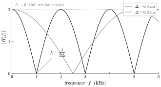
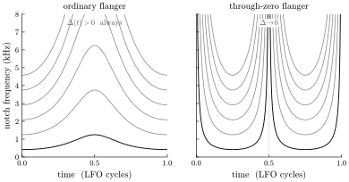
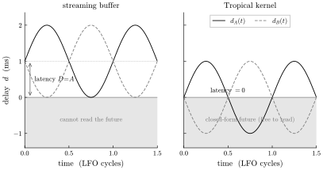

# Through-zero flanging

*Why the canonical tape-studio effect cannot be done at zero latency on a
sample stream, and why it is free in Tropical.*

Flanging began as an accident of tape. Play the same recording on two
reels at once, sum them to a third, and rest a thumb on the *flange* of
one reel to slow it a hair. The two copies drift apart in time; their
sum develops a moving comb of cancellations — the swept, hollow,
jet-plane whoosh. The prized moment is the one where you release the
first reel and press the second: the copy that was lagging catches up,
the two pass through perfect alignment, and the relative delay crosses
*through zero* and reverses sign. At that instant every notch flees to
infinity, the sound opens completely, and the sweep continues out the
far side. That is **through-zero flanging** (TZF), and every digital
flanger that does *not* do it is poorer for the same reason: it cannot,
without paying a cost the tape machines paid invisibly.

## Two copies, slightly apart

Everything a flanger does comes from one small fact about adding a sound
to a slightly late copy of itself. Fix on a single frequency in the sound.
If the copy is delayed by exactly half of that frequency's cycle, it
arrives crest-against-trough and the two cancel to nothing; if it is
delayed by a whole cycle, it arrives crest-against-crest and they
reinforce. The same fixed delay is a different fraction of every
frequency's cycle, so across the spectrum the sum comes out as a row of
evenly spaced nulls — deep notches, total cancellation — with
reinforcement in the bands between them. That row of notches is the comb,
and it is the entire sound of a flanger: a hollow, metallic coloration
that is nothing more than a set of missing frequencies.

*Figure 1. Adding a signal to a delayed copy cancels the frequencies that
fall half a cycle out of step and reinforces the ones that fall in step —
a comb of notches whose spacing is set by the length of the delay alone.*

How far apart those notches sit is fixed entirely by the delay — call it
$\Delta$, the gap between the two copies. Lengthen $\Delta$ and the notches
crowd together; shorten it and they spread apart; let $\Delta$ fall all the
way to zero and the lowest notch climbs up out of hearing until the comb
goes flat — the copy has caught the original, the two are one signal, and
every frequency reinforces at once. Sweep $\Delta$ slowly with a low
oscillator and the whole comb glides up and down the spectrum. That gliding
rake of cancellations, drawn across the sound, is the flange.

An ordinary flanger sweeps $\Delta$ but never lets it reach zero: the copy
stays behind the original, always late, never level and never early. So
the comb can only breathe within limits — its lowest notch sinks toward a
floor and turns back before the comb can open. Getting it to open all the
way — through the instant the copy draws level, the notches scatter upward
out of hearing, and the comb dissolves into pure reinforcement — is the
whole game. It is also where the trouble starts.

## Through zero

Through-zero flanging is the case where $\Delta(\tau)$ is allowed to
*cross zero* — to go from the delayed copy lagging to the delayed copy
leading. When it does, the comb does something an ordinary flanger's
never does: every notch simultaneously sweeps up through the top of the
spectrum, the comb momentarily vanishes into flat reinforcement (or, if
one path is inverted, into a single deep notch at DC — total silence),
and then the whole comb re-emerges from infinity as $\Delta$ opens up
with the opposite sign.

*Figure 2. Notch centre frequencies $f_k(\tau) = (2k+1)/(2|\Delta(\tau)|)$
over one LFO cycle. Left: an ordinary flanger holds $\Delta > 0$, so the
notches wiggle within bounded bands. Right: through-zero lets $\Delta$
reach zero, and at each crossing the entire comb fans up through the
ceiling — the effect "opens" and turns inside out.*

The whole character of the effect — the way it seems to breathe through
a point of perfect stillness rather than merely wobble — lives in that
sign change. To get it you need $\Delta$ to pass through zero. Which
means one tap must, for part of the cycle, be *ahead* of the other.

## The causality wall

Here is where a sample stream hits a wall it cannot climb.

A real-time audio stream is causal. At sample $n$ the buffer holds
$x[n], x[n-1], x[n-2], \dots$ — the present and the past. It does not
hold $x[n+1]$. Reading a delayed value $x(\tau - d)$ therefore requires
$d \ge 0$: you can look back, never ahead. Both taps obey it:
$d_A \ge 0$ and $d_B \ge 0$.

Now ask for a symmetric through-zero sweep, $\Delta$ ranging over
$[-\Delta_{\max}, +\Delta_{\max}]$. Write the two taps around a common
bias $D$:

$$ d_A(\tau) = D + m(\tau), \qquad d_B(\tau) = D - m(\tau), \qquad m \in [-A, A], $$

so that $\Delta = 2m$ does sweep symmetrically through zero. The
non-negativity constraint $d_A, d_B \ge 0$ forces

$$ D \;\ge\; A. $$

You cannot make the bias smaller than the sweep amplitude without one
tap demanding a negative delay — a sample from the future. So the
*dry* path is no longer dry: it is delayed by $D$. And that $D$ is pure
latency — the output at "now" reflects input from $D$ seconds ago,
every sample, forever.

*Figure 3. Both panels realise the identical relative delay
$\Delta(\tau) = 2A\sin(2\pi f_{\text{lfo}}\tau)$ — the same audible
flange. Left: a causal buffer can only read the shaded past, so both
taps must be lifted onto a bias $D = A$; the sweep touches the $d = 0$
wall but never crosses it, and the bias is a fixed latency. Right: with
no such wall the taps sit symmetric about zero and the latency is zero.*

This is exactly what the tape machines were doing. Both reels ran their
tape across a physical playback head at a physical transport delay — the
bias $D$ was baked into the medium, so nobody thought of it as latency.
Crossing through zero cost them nothing extra because they had *already
paid* $D$ just by being tape. A digital flanger that wants the same
effect must reintroduce that delay deliberately, and wear it as latency.
There is no way around it on a stream. The impossibility is not a
missing feature; it is causality. **You cannot read a sample that has
not arrived.**

## Tropical: the delay is an argument, not a buffer

Tropical does not have a stream to be delayed. Every signal in a patch
is a closed-form kernel — a pure function of a time coordinate,

$$ x \;=\; f(\tau, \text{params}), $$

with no per-sample state and no buffer of past samples. A "delay by $d$"
is not a read from a ring buffer; it is the *same function evaluated at a
shifted argument*, $x(\tau - d)$. And a function does not care about the
sign of its argument. Evaluating $x(\tau + a)$ — looking $a$ seconds
"ahead" — is arithmetically identical to, and exactly as cheap as,
$x(\tau - a)$. There is no present moment past which the data runs out,
because there is no data: there is a formula, and $\tau$ is a free
coordinate you may pass whatever you like.

So the constraint $d \ge 0$ simply does not exist. Put the taps
symmetric about zero:

$$ d_A(\tau) = -m(\tau), \qquad d_B(\tau) = +m(\tau), \qquad \Delta = 2m(\tau), $$

and $\Delta$ sweeps cleanly through zero with **no bias and no latency**
(Figure 3, right). The through-zero moment is exact, and it is now.

Better still, the entire effect collapses back into a single closed-form
kernel. With $m(\tau) = A\sin(2\pi f_{\text{lfo}}\tau)$,

$$ y(\tau) \;=\; x\bigl(\tau + m(\tau)\bigr) \;+\; x\bigl(\tau - m(\tau)\bigr) $$

is itself just another $f(\tau, \text{params})$ — no delay line, no
interpolation, no state to carry across the zero crossing. Two
consequences fall out for free:

- **Nothing clicks.** A streaming flanger modulates a delay-line read
  pointer, which pitch-shifts and needs fractional-delay interpolation;
  push it hard and it zippers. Here there is no latched read pointer to
  jerk — phase is computed from $\tau$, so the sweep through zero is as
  smooth as the LFO that drives it.
- **The delay is exact.** $x(\tau - m(\tau))$ is evaluated at the true
  real-valued argument, not snapped to an integer sample and interpolated.
  There is no delay-line quantisation error to alias.

## Scope, and the moat it belongs to

The honest boundary: this is exact precisely when $x$ is closed form —
when the flanged signal is *synthesised inside the patch*. For live or
external input there is no $f(\tau)$ to evaluate ahead of the present, so
the causality wall stands again. That case is the ceded island —
recursive filtering of live/external input, deferred to a future
stateful sister runtime — and it is ceded on purpose. Within the
language's actual domain, patch synthesis, through-zero flanging is a
first-class, zero-latency, artifact-free operation.

And it is not a special trick. It is one small, legible instance of the
single property the whole instrument is built on: **every signal is a
closed-form function of the time coordinate, so time is random-access.**
The same fact that makes through-zero free makes $\tau$-scrubbing free,
makes a reverse reverb (a convolution reaching *forward* in time) free,
makes a consumer at a different rate correct for any patch. A sample
stream forbids reading the future; a formula has no future to forbid.
Through-zero flanging is just the place where that difference is easiest
to hear.
